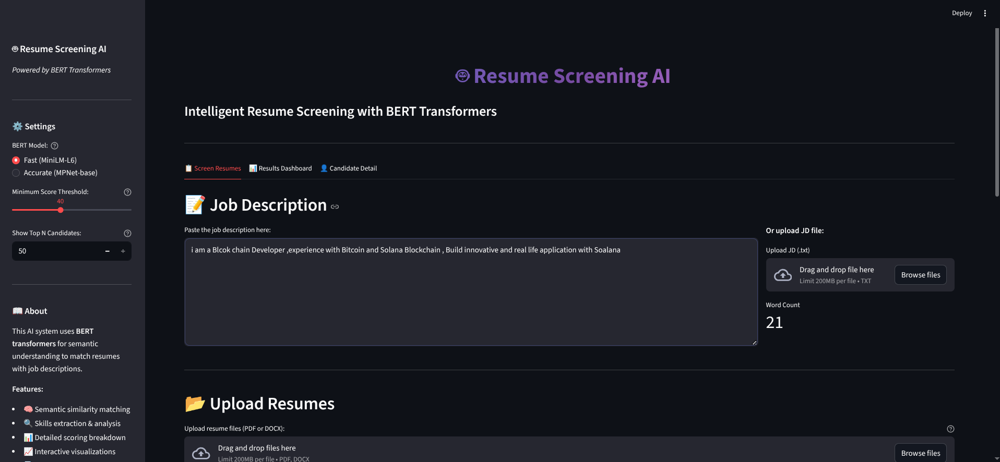

# 🤖 Resume Screening AI

> BERT-powered intelligent resume screening — semantic matching, NER extraction, and interactive analytics.


---

## 📸 Interface



---

## ✨ Features

| Feature | Description |
|---|---|
| 🧠 BERT Semantic Matching | Deep learning similarity between resumes and job descriptions |
| 🔍 NER Entity Extraction | Auto-extracts skills, experience, education & contact info |
| 📊 Weighted Scoring | Semantic 40% · Skills 30% · Experience 20% · Education 10% |
| 📈 6 Interactive Charts | Rankings, radar, heatmap, distribution, scatter, donut |
| 🎯 Skills Gap Analysis | Matched vs missing skills per candidate |
| 📄 PDF Report Export | Professional ReportLab-powered screening reports |
| 🚀 Bulk Processing | Screen 10–50 resumes simultaneously |

---

## 🏗️ Architecture

```
resume_screening_ai/
├── app.py                  # Main Streamlit application
├── requirements.txt        # Dependencies
├── core/
│   ├── bert_matcher.py     # BERT semantic matching (core engine)
│   ├── scorer.py           # Scoring & ranking logic
│   ├── extractor.py        # PDF/DOCX text extraction
│   ├── preprocessor.py     # Text cleaning & segmentation
│   └── ner_extractor.py    # Named Entity Recognition (spaCy)
├── utils/
│   ├── skills_database.py  # 100+ technical & soft skills
│   └── report_generator.py # PDF report generation
└── ui/
    ├── styles.py           # Custom CSS / glassmorphism
    └── charts.py           # Plotly visualizations
```

---

## 🚀 Quick Start

```bash
# 1. Install dependencies
pip install -r requirements.txt

# 2. Download spaCy NER model (~400MB)
python -m spacy download en_core_web_lg

# 3. Run the app
streamlit run app.py
```

Open **http://localhost:8501** in your browser.

---

## 📖 How to Use

1. **Paste the Job Description** — or upload a `.txt` file
2. **Upload Resumes** — PDF or DOCX (multiple files at once)
3. **Click "🚀 Screen All Resumes"** — BERT model loads and processes
4. **Review Results** — ranked table, charts, and per-candidate profile
5. **Export** — Download CSV or full PDF report

---

## 🎯 Grading System

| Grade | Score | Action |
|---|---|---|
| **A** | 80–100% | Shortlist immediately |
| **B** | 65–79% | Worth interviewing |
| **C** | 50–64% | Review manually |
| **D** | 35–49% | Missing key requirements |
| **F** | < 35% | Not suitable |

---

## 🛠️ Tech Stack

| Layer | Technology |
|---|---|
| UI | Streamlit · Plotly · Custom CSS |
| NLP / ML | sentence-transformers · spaCy · NLTK · PyTorch |
| Parsing | PyPDF2 · python-docx |
| Reporting | ReportLab |

---

## 👤 Author

**Zahid Iqbal** — [GitHub @ZahidMiana](https://github.com/ZahidMiana)
